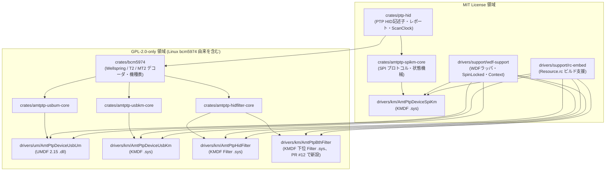

# `mac-precision-touchpad` 構造・ロジック改善監査レポート

本レポートは、C実装からRust（`windows-drivers-rs` / `wdk-sys` 0.5.2）へ移植された現在のコードベース全体を対象に、**破壊的変更を許容したアーキテクチャ刷新**から**即座に修正可能なバグ・競合・重複排除**、さらに**ライセンス・ドライバ署名・旧公式配布パッケージ（`ReleaseMSSigned`）との互換性**までを体系的に整理した調査結果です。

現在のコードベースは「C実装の挙動（バグや不整合を含む）を1バイト単位で再現する（C-oracle parity）」という移植方針のおかげで高いテストカバレッジを持っていますが、移植が完了しPhase 1〜3の初期整理（PR #6〜#8）を経た現在、**「C時代の歴史的負債・バグ互換を意図的に捨てること」**が最大の改善レバーになっています。

---

## 進捗と監査内容の訂正（2026-11-27 時点）

### Step 1 の完了

| PR | マージコミット | 内容 |
| --- | --- | --- |
| #9 | `9e13348` | Step 1 の全項目。1 項目 1 コミット：`B-1`、`B-2`、`B-3`、`C-1`、`C-2`（`ScanClock` のみ）、単体 `AmtPtpHidFilter.inx` の廃止、`D-1` |
| #10 | `7a28355` | 実機テストで見つかった Bluetooth の不具合 2 件の修正と、モード切替トレースの拡充 |
| #11 | `74c5c46` | Bluetooth パケット欠落を C 版でも計測した結果の記録（文書のみ） |

**実機テスト**：Magic Trackpad 2（`PID_0265`, `REV_0871`）、Windows 11 build 26300、テスト署名パッケージで行いました。

- **USB**：問題なし。
- **Bluetooth**：PR #9 の時点で不具合が 2 件見つかり、PR #10 で直しました。
  1. ジェスチャ中に入力が 3 秒固まる。原因は、`B-1` の対策案どおりに入れた「失敗した Read はタイマーで再試行」です（下の訂正 1）。
  2. トラックパッドの電源スイッチを入れ直すと、カーソルが動かなくなる。PnP イベントが起きないまま、トラックパッドがマウスモード（レポート `0x02`）で戻ってくるのに、モード切替を送り直す処理がありませんでした。C 版にも同じ穴があります。
- **PR #10 マージ後の main**（パッケージ `2026.1127.12.1`）：ジェスチャと電源の入れ直しで正常に動きました。スリープ復帰は、同じロジックの診断版で確認しています。

### `B-5` と `A-3`（フック廃止）の完了（PR #12）

| PR | マージコミット | 内容 |
| --- | --- | --- |
| #12 | `486824b` | `B-5` の修正と `A-3` のフック廃止。HidBth の下に下位フィルタ `AmtPtpBthFilter` を新設し、`AmtPtpHidFilter` は HIDCLASS の detour をやめて、新しいコレクション `Col03` から読む |

ロードマップでは Step 4 の項目ですが、実機で見つかった欠落を直すため、Step 2・3 より先に行いました。

- **設計**（詳細は [bthfilter.md](bthfilter.md) と [hidfilter.md](hidfilter.md) の「The data source」）
  - `AmtPtpBthFilter` は、HidBth が起動時に読む SDP の HID 記述子に、ベンダー定義のコレクション（入力 `0x31`、機能 `0xF1`）を書き足します。HIDCLASS はこれを `Col03` として公開し、`0x31` を自分で配送します。
  - HIDCLASS は宣言より短いレポートを捨てるので、割り込みチャネルの `0x31`（4 + 9n バイト）を 140 バイトに詰め直し、本来の長さを最後のバイトに入れます。マウスレポート `0x02` は「モードが外れた」目印に変えます。
  - `AmtPtpHidFilter` は `Col03` を普通の HID クライアントとして開きます。`IRP_MJ_READ` で読み、モード切替はクラスの `IOCTL_HID_SET_FEATURE` で送ります。detour（`hac.rs`、`detour.rs`）は削除しました。
  - HIDCLASS が HidBth の唯一の読み手になるので、パケットの取り合いがなくなります。
- **実機の結果**（Magic Trackpad 2 `REV_0871`、Windows 11 build 26300、x64、テスト署名）
  - 1〜3 本指のジェスチャ 20 秒で、次の 3 つが毎秒一致しました（計 879 件）：無線上の割り込みパケット（BTHPORT の HCI トレース）、`AmtPtpBthFilter` が詰め直したレポート、`AmtPtpHidFilter` が返したレポート。欠落 0、`DATA_ERROR` 0 です。
  - 電源スイッチの入れ直し：目印を受けてモード切替を送り直し、約 0.1 秒でマルチタッチに戻りました。
  - `Col03` の無効化・有効化と、Windows の再起動のあとも入力できました。
- **未確認**：スリープ復帰、再起動後の欠落件数（879 件の計測は再起動前）、ARM64 実機（ビルドのみ）。
- **未決定**：`AmtPtpBthFilter` のライセンス。仮に `GPL-2.0-only` にしています（`0-1` の補足）。

### Step 2 の完了

- **A-2**：
  - `crates/ptp-hid`（MIT、`no_std`、ヒープ確保なし、`forbid(unsafe_code)`）に `ContactTracker` を実装し、全 4 ドライバ（`SpiKm`、`UsbKm`、`UsbUm`、`HidFilter`）に統合しました。Wellspring / T2 / SPI では最近傍マッチング（ユークリッド距離閾値 `3200`）で接触ごとの永続 `ContactID` を維持し、Magic Trackpad 2（USB・Bluetooth）ではハードウェアの接触 ID（`0..=15`）を追跡します。接触終了時は最終座標のまま 1 フレーム分の `TipSwitch = 0, Confidence = 1` 離床通知を生成し、一度 `Confidence = 0`（パーム）になった接触は離床までラッチします。
  - Wellspring / T2（`bcm5974::input::wellspring_contact`）の `Confidence` 判定を反転していた `minor > 0` から `major < 2500 && minor < 2500` に修正しました。
  - Magic Trackpad 2 の USB・Bluetooth 共通デコーダで 13 ビットの Y を符号拡張してから反転し、全機種（MT2・Wellspring・T2・SPI）で X・Y を HID 記述子の論理範囲 `0..=logical_max` にクランプしました。あわせて SPI Series 1（`AXES_F1`）の `y_logical_max` を `6217`、`UsbUm` の `Ws5a` / `Ws9` を `Ws7a`（`10030×6880`）/ `Ws9`（`10173×7006`）、`UsbKm` の 13 インチ T2（`0x027a` / `0x027b`）を `12992×7855`（物理 `1352×836`）に整合させました。
  - `ptp-hid::descriptor` から C 互換の欠落版ビルダを廃止し、全 5 指コレクション末尾と `Scan Time` 直後に `GLOBAL_RESET`（`45 00 55 00 65 00`）を入れ、`Input Mode`（`Usage 0x52`）の `LOGICAL_MAXIMUM` を `0x03`（`PTP_COLLECTION_WINDOWS`）に統一しました（レポート記述子長：`UsbKm` / `HidFilter` 511 バイト、`SpiKm` 519 バイト、`UsbUm` 534 バイト）。
- **B-4**：
  - 4 ドライバすべての `GET_DEVICE_ATTRIBUTES` 応答で予約領域 `Reserved`（後半 22 バイト）をゼロにしました。
  - `UsbUm` の `GET_STRING` は NUL 終端を含む UTF-16LE のバイト数を返し、短いバッファへの部分コピーを防ぎ、未知の文字列 ID には `STATUS_NOT_SUPPORTED` を返します。`SET_FEATURE` は未対応 ID、短い入力、USB 転送失敗を呼び出し元に返します。
  - `SET_FEATURE 0x04`（`Input Mode`）と入力ゲートを整合させました。`SpiKm` と `HidFilter` は起動時および `PrepareHardware` 後に `PtpInputOn = true` で開始し、`0x00`（マウスコレクション）が設定された際は接触・ボタンの両方を抑止して `ContactTracker` をリセットします。`UsbKm` は 2 バイト未満の `0x04` を `STATUS_INVALID_BUFFER_SIZE` で拒否し、モード `0` で `set_wellspring_mode(..., false)` を送出して `STATUS_SUCCESS`（または転送失敗ステータス）を返し、Wellspring モード OFF 中の受信パケットは `READ_REPORT` を消費せず破棄します。

**実機確認（Step 2 完了版：2026-11-27、Windows 11 build 26300 x64、Magic Trackpad 2 `REV_0871`）**。テスト署名版 `2026.1127.44.1`（`oem233.inf`）へ USB・Bluetooth 全 5 デバイスノードを差し替え、実機 HID API で Bluetooth PTP コレクションの `PreparsedData`（`Input Mode` `Log=[0..3], Units=0, Phys=[0..0]`、`Contact Count` `Units=0, Phys=[0..0]`、`X` `0..7612`、`Y` `0..5065`、`Scan Time` `Units=0x1001, Exp=-4`）に状態リークが無いことを確認しました。5 プロバイダの TraceLogging（計 2,236 イベント、`EventsLost=0`）では、USB 差し替え・USB 抜去時 `D0Exit` 正常完了（`0xC000000E` 抑止）、Bluetooth `SdpAugmented`（`271 -> 310`B）・`MultitouchModeSet` 復帰（`33 ms`）後、1〜4 本指入力 524 フレームすべて `Status=0x0` で配送され、`LowerReadFailed`・`MalformedInput`・`DeviceSetFailed`・`PadSkipped` および Windows イベントログのドライバエラーはいずれも 0 件でした。

**中間実機確認（PR #13 時点：2026-11-27、Windows 11 build 26300 x64、Magic Trackpad 2 `REV_0871`）**。テスト署名版 `2026.1127.43.1`（`oem231.inf`）に差し替え、Bluetooth と USB でポインター移動と 2 本指スクロールを確認しました。Bluetooth は最後のモード切替成功から USB を接続するまでに `ReportPadded` と成功した `RequestCompleted` が各 1,762 件で、`LowerReadFailed` は 0 件でした。差し替え時の `STATUS_CANCELLED` の後は、ソースを開き直してモード切替に成功しました。USB では HID API でデバイス属性、終端付きのメーカー名と製品名を取得し、20 バイトのバッファでは `ERROR_INSUFFICIENT_BUFFER` を確認しました。

### 監査内容の訂正

1. **`B-1` の対策案「失敗した Read はタイマー経由でのみ再試行」は、実機では誤りでした。**
   - HidBth は、正常に使っている最中にもときどき `STATUS_DEVICE_DATA_ERROR` で Read を失敗させます。
   - そのたびに 3 秒待つと、失敗が 2 回続いた時点で保留中の Read がなくなり、入力が 3 秒止まりました。
   - 最終的な設計：失敗した Read は WorkItem ですぐに再発行します（C と同じ）。連続 `MAX_IMMEDIATE_READ_RETRIES`（8）回を超えたら 3 秒タイマーに切り替えるので、無限ループも防げます。
2. **`A-3` の「アンロードするとダングリングポインタで BSOD」は誤りでした。**
   - detour が `MajorFunction[0x0F]` に書き込むのは、HIDCLASS が保存していた **HidBth 自身の元のハンドラ**です。フィルタの関数ではないので、フィルタをアンロードしても無効なポインタは残りません。
   - 実際の影響は次の 2 つです。HidBth のデバイスオブジェクトに直接送られる内部 IOCTL が HIDCLASS を経由しなくなることと、それが戻されないこと（`HF-B26`）。
   - 単一 INF 化（PR #9）以降、フィルタが入るのは Bluetooth の `Col01` だけです。
3. **`A-3` の改善案 1（ファイルハンドル付き `WDFIOTARGET` で HID コレクションから読む）は、そのままでは成り立ちません。**
   - SDP の HID 記述子（135 バイト）が宣言しているのは、入力 `0x02` / `0x90` と機能 `0x55` だけです。マルチタッチのレポート `0x31` もモード切替の `0xF1` も宣言されていません。
   - そのため、HIDCLASS のコレクション経由では `0x31` は届きません。詳しくは新項目 `B-5`。
4. **`B-3` のタイムアウト値は 5 s にしました**（提案は 500ms〜2s）。データステージ付きの USB 2.0 コントロール要求の上限に合わせています（`wdf_support::init::SYNC_IO_TIMEOUT`）。
5. **`B-3` の 2（`UsbUm` の緊急リセットを WorkItem に移す）は意図的に見送りました。**
   - このリセットのコントロール転送は、停止する割り込みパイプではなくデフォルトパイプに送られるので、デッドロックは起きません。
   - `UsbUm` は `A-1` で削除する予定です。
6. **`B-5` の `DATA_ERROR` の仕組みが分かりました**（HidBth の下に置いたトレース専用フィルタで確認）。
   - HIDCLASS の Read は 8 バイト（元の記述子で最長のレポート）なので、HidBth はそれを 9 バイトの転送で受けます。13 バイト以上のマルチタッチパケットはそこで分割され、残りは次の転送に回ります。
   - 頭を受けた HIDCLASS はパケットを捨て（欠落）、残りがフィルタの Read に入ると `STATUS_DEVICE_DATA_ERROR` で失敗していました。1 回の計測の 27 件すべてがこの形でした。
   - 欠落のあとに 0.5〜1.5 秒あくのは、HIDCLASS がエラーのあと約 1 秒待つ（`HidpPingpongBackoffTimerDpc`）ためです。
7. **訂正 3 は、下位フィルタで記述子に宣言を足すことで解消しました**（PR #12）。`A-3` の改善案 1（標準の I/O ターゲットで HID コレクションから読む）がそのまま使え、VHF は不要でした。

---

## 0. 前提整理：ライセンス・著作権とドライバ署名の現実

リファクタリングやクレート統合の方針を決めるにあたり、[LICENSE.md](../../LICENSE.md) のライセンス構成および Windows ドライバ署名要件を正確に押さえておく必要があります。



### 0-1. ライセンス変更の可否（なぜ GPLv2 は外せず、GPLv2 への統一なら可能なのか）

1. **MIT 側を GPLv2 に寄せる（全体を GPLv2 に統一する）→ 【法的に可能】**
   - [LICENSE-MIT.md](../../LICENSE-MIT.md) は `merge, publish, distribute, sublicense` を認めているため、MIT ライセンスは **GPLv2 と互換（GPL-compatible）** です。
   - 元の著作権表示と MIT 許諾文を保持したまま、`AmtPtpDeviceSpiKm` や `amtptp-spikm-core` を GPLv2 側と統合し、派生成果物全体を GPLv2 として扱うことは法的に問題ありません。
2. **GPLv2 側を MIT に変更する（全体を MIT にする）→ 【そのままでは不可】**
   - ほぼ全コードが Rust に書き換えられていても、元の C コード（コミット `2edb0f2`）を1行ずつ解析して構造・定数・分岐ロジックを移し替えた別言語移植（Porting）は、著作権法上の **「翻訳・翻案（二次的著作物）」** に該当し、元コードへの **依拠性** が残ります（[specs/crosscut.md](specs/crosscut.md)）。
   - さらに [crates/bcm5974/src/config.rs](../../crates/bcm5974/src/config.rs) 等には、ハードウェアの事実（VID/PID や通信バイト列）だけでなく、Linux カーネル `drivers/input/mouse/bcm5974.c`（**GPL-2.0-only**）から流用された構造体設計や経験的パラメータ表（未使用の `snratio = 250` 等を含む）が引き継がれています。
   - したがって、GPL コードを参照しないクリーンルーム再実装を行うか、関与した全著作権者（元作者＋Linux `bcm5974` 著者陣）の許諾を得ない限り、GPLv2 を外して MIT 等へ再ライセンスすることはできません。
   - 一方で、**GPLv2 のまま元の C 構造やバグ互換を完全に捨てて別設計へ作り変える（破壊的リファクタリング）ことは100%自由**です。
3. **補足：PR #12 の新規コード（ライセンス未決定）**
   - `AmtPtpBthFilter` と `amtptp_hidfilter_core::bth` は C に対応するコードがない新規実装で、C コードの移植ではありません。
   - ただし `bth` は GPL の `amtptp-hidfilter-core` クレートの中にあり、`AmtPtpBthFilter` はそれ（`bth` だけ）をリンクしています。そのため現状は、クレートの指定どおり `GPL-2.0-only` です。
   - `AmtPtpBthFilter` を MIT などにしたい場合は、`bth` を MIT のクレート（`ptp-hid` か新しいクレート）に移す必要があります。

### 0-2. `GPL-2.0-only` における実務上の注意点

| 観点 | 内容と影響 |
| --- | --- |
| **① Microsoft 正規ドライバ署名（最大の制約）** | Microsoft Partner Center（WHQL / Attestation Signing）の提出規約は、GPLv2/v3 等のコピーレフト（"Excluded License"）を含むドライバの提出を禁じています。正規署名を通したい場合は GPLv2 が障壁になります（元作者が `SpiKm` だけ MIT にした理由もここにあると考えられます）。 |
| **② `Apache-2.0` 単体クレートとの非互換** | 本リポジトリは `GPL-2.0-only` であり、`Apache-2.0` 単体や `GPL-3.0` とは非互換です。Rust エコシステムの主流（`wdk-sys`, `tracelogging` 等）は `MIT OR Apache-2.0` のデュアルライセンスなので `MIT` 側を選べば問題ありませんが、将来依存クレートを追加する際は **`Apache-2.0` 単体クレートを入れない**よう注意が必要です。 |
| **③ WDK 静的ライブラリとのリンク** | WDK のスタブ `.lib`（`WdfDriverEntry.lib` 等）とのリンクが GPLv2 のシステムライブラリ例外に該当するかは法務上のグレーゾーンとされることがありますが、個人利用・OSS ソース公開運用では実質的な問題にはなりません。 |
| **④ 共通クレート設計の最適解** | たとえ `SpiKm` の MIT を維持したい場合でも、**「MIT の下位クレート（`ptp-hid`, `wdf-support`）に共通処理を集約し、GPLv2 側と MIT 側の両方から依存する」方向は完全に合法**なため、ライセンスを変えずとも大半の共通化が実現できます。 |

### 0-3. 旧公式配布版（`Drivers-amd64-ReleaseMSSigned`）と同じ使い方をするための条件

元リポジトリの配布パッケージ（`DriverVer = 06/02/2021,2021.3979.1.1000`）および実機 **Magic Trackpad (`PID_0265`, `REV_0871`)** の稼働状態を照合した結果、以下の事実が確認されています：

1. **署名とインストール手順の現実**：
   - 旧配布版の全バイナリ（`.cat`, `.sys`, `.dll`）には `CN=Microsoft Windows Hardware Compatibility Publisher`（Partner Center の正規 Attestation 署名）が付与されていたため、`TESTSIGNING` OFF の通常環境でも `AmtPtpDevice.inf` の右クリックだけで導入できました。
   - 本リポジトリで改修・再ビルドしたバイナリには Microsoft 署名を付与できないため、個人環境で同じく **`AmtPtpDevice.inf` 右クリックインストール＋Bluetooth ペアリング／USB 接続だけ** で運用するには、**テスト署名モード（Secure Boot OFF ＋ `bcdedit /set testsigning on`）を有効化し、`cargo xtask package --arch x64 --sign` で自己署名パッケージを生成する** のが現実解となります。
   - 64bit Windows 10/11 では UMDF ドライバ（`.dll`）であっても `.cat` カタログへの署名要件は KMDF（`.sys`）とまったく同じであるため、**UMDF を残しても署名・導入上のメリットはありません**。
   - ※BitLocker（`FVEBOOT`）が有効な環境で `bcdedit /set testsigning on` に切り替える際は、事前に BitLocker 保護を一時中断するか回復キーを手元に控えておく必要があります。
   - **実機で確認済み（2026-11-27）**：Secure Boot OFF、`testsigning` ON、WDK テスト証明書を `Root` と `TrustedPublisher` に登録した環境で、自己署名パッケージが `devcon update` で入り、動きました。HVCI は有効のままで問題ありませんでした。
2. **単一 INF パッケージ構成の踏襲**：
   - 旧配布版は **`AmtPtpDevice.inf` 1ファイルのみ** を同梱しており、単体の `AmtPtpHidFilter.inf` は存在しません。一方、現在のリポジトリの `packaging/AmtPtpHidFilter.inx`（PR #9 で削除）は `REV_0855` をハードコードしているため **`REV_0871` 等の実機にマッチせず**、[packaging/AmtPtpDevice.inx](../../packaging/AmtPtpDevice.inx) とも競合しています。旧配布版と同じ使い勝手を維持するため、`AmtPtpDevice.inx` 1本への統一が適切です。
   - **対応済み（PR #9）**：`packaging/AmtPtpHidFilter.inx` を削除し、`cargo xtask package` の `--inf` オプションも廃止しました。
3. **元作者の未完計画との一致**：
   - 旧配布版の `AmtPtpDevice.inf` 内には、Magic Trackpad 2 USB の `UsbUm` バインディング直前に次のコメントが残されています：
     > `; Note: this will be a last few versions where Magic Trackpad 2 uses this old implementation`
   - つまり、古い UMDF 実装（`AmtPtpDeviceUsbUm.dll`）を廃止して KMDF 側へ統合する方針（後述 `A-1`）は、元リポジトリの設計意図とも完全に一致しています。

---

## 改善テーマ優先度マトリクス

| ID | カテゴリ | 改善項目 | 破壊的変更 | 効果 | 難易度 | 状態（2026-11-27） |
| --- | --- | --- | --- | --- | --- | --- |
| **A-1** | 構造刷新 | USBドライバ（`UsbUm` / `UsbKm`）の単一KMDF化と単一INFパッケージへの整理 | **Yes** (INF/構成) | 極大 | 中 | 未着手 |
| **A-2** | ロジック刷新 | PTP接触ライフサイクル（ID追跡・Liftoff）と座標/Confidence計算の修正 | **Yes** (C互換破棄) | 極大 | 中 | 完了（PR #13 および Step 2 残項目） |
| **A-3** | 構造刷新 | `AmtPtpHidFilter` の非公開 `HIDCLASS` パッチ廃止（標準フィルタ / VHF化） | **Yes** (ドライバ構成) | 大 | 高 | 一部：単体 INF の廃止（PR #9）とフック廃止（PR #12。VHF ではなく、下位フィルタ＋`Col03` の標準 I/O ターゲット）は済。DCH 準拠化は未着手 |
| **A-4** | 仕様整理 | 壊れている Settings アプリ契約（`apps/settings` / `UMAPP_TLC` / 未使用GUID）の撤去（または再設計） | **Yes** (機能整理) | 中〜大 | 低〜中 | 未着手 |
| **B-1** | 重大バグ | `AmtPtpHidFilter` の100% CPU無限ループ・スリープ復帰レース・ReportID未検証の修正 | No | 極大 | 低〜中 | 完了（PR #9。実機で見つかった問題は PR #10 で修正） |
| **B-2** | 電源管理 | USB抜去時（`D3Final`）の `D0Exit` エラー抑止と終了時モード復帰の統一 | No | 大 | 低 | 完了（PR #9） |
| **B-3** | 排他・I/O | USBモード切替の排他制御、`UsbUm` 完了コールバック内同期リセット廃止、I/Oタイムアウト設定 | No | 大 | 低〜中 | 完了（PR #9。2 は見送り、訂正 5） |
| **B-4** | HID準拠 | `SET_FEATURE` / `GET_STRING` / `HidDeviceAttributes` の戻り値・ゼロ初期化統一 | 一部 | 中 | 低 | 完了（PR #13 および Step 2 残項目） |
| **B-5** | 入力欠落 | Bluetooth 入力パケットの約 3.5% 欠落（HIDCLASS との読み取り競合、C 由来）（実機調査で追加） | **Yes** (ドライバ構成) | 中 | 高 | 完了（PR #12。実機で欠落 0、`DATA_ERROR` 0） |
| **C-1** | 型安全性 | `wdf-support` の `declare_context_type!` への `T: Sync` 強制と `SpinLocked` 改善 | No | 大 | 低 | 完了（PR #9） |
| **C-2** | 並行性 | `ScanClock` および `SharedDeviceConfig` の `Relaxed` アトミック競合解消 | No | 中 | 低 | 一部：`ScanClock` は済（PR #9）、`SharedDeviceConfig` は未着手 |
| **C-3** | 重複排除 | 4つの `*-core` クレートの共通型統合と `FilterIo` モックトレイトの純粋関数化 | No (内部API) | 大 | 中 | 一部：`ReadTracker` だけ `ptp-hid` に抽出済（PR #9） |
| **D-1〜3** | 基盤・保守 | CIでの実リンク/パッケージ検証追加、`.rc` リソース生成統一、ドキュメント乖離解消 | No | 中 | 低 | 一部：`D-1` は済（PR #9）、`D-2`・`D-3` は未着手 |

---

## 第1部：破壊的変更を伴うアーキテクチャ・プロトコル刷新案

### A-1. `AmtPtpDeviceUsbUm` (UMDF) と `AmtPtpDeviceUsbKm` (KMDF) の統合

#### 現状の課題
USB接続のAppleトラックパッド向けに、現在 **UMDF 2.15 ドライバ (`AmtPtpDeviceUsbUm`)** と **KMDF ドライバ (`AmtPtpDeviceUsbKm`)** の2つが並存しています。どちらも `WDFUSBDEVICE` と `bcm5974` パケットデコーダを使う同一アーキテクチャであり、分かれている理由はC実装時代の歴史的経緯（当初UMDFで書かれ、T2チップ対応時にKMDFへフォークされたこと）のみです。

この二重構造が以下のコストと不具合を生んでいます：
1. **INFのOSビルド分岐による実機バグ**：[packaging/AmtPtpDevice.inx](../../packaging/AmtPtpDevice.inx#L32-L125) でビルド `16299`（Win10 1709）向けセクションは全機種を `AmtPtpDeviceUsbKm` にバインドし、`17134`（1803以降）では旧MacBookとUSB MT2を `AmtPtpDeviceUsbUm`、T2機種のみを `AmtPtpDeviceUsbKm` に振り分けています（なお旧公式配布版 `ReleaseMSSigned` の `AmtPtpDevice.inf` では単一 `[Standard.NTamd64]` 内で `0273`/`0274`/`0290`/`0291` が KM と UM の両方に重複記載されていました）。しかし **`AmtPtpDeviceUsbKm` 側の [config.rs](../../crates/amtptp-usbkm-core/src/config.rs#L15-L20) には PID `0x0290` / `0x0291`（Wellspring 8、`Type3`）の定義が無く、`T2_FALLBACK`（`Type4`）へフォールバックしてしまいます**。結果として `UsbKm` 側が選ばれるとヘッダ長もモード切替パラメータも噛み合わず動作しません。
2. **ビルド・パッケージング上のハックの温床**：
   - UMDFのためだけに別ワークスペース [drivers/um/Cargo.toml](../../drivers/um/Cargo.toml#L47-L53) と別 `Cargo.lock` が必要。
   - `wdk-build` が `/INTEGRITYCHECK` を強制するため、[tools/xtask/src/package.rs](../../tools/xtask/src/package.rs#L341-L379) の `clear_force_integrity` で生成後のDLLのPEヘッダ（`Characteristics` の `0x0080` ビット）を直接バイナリ書き換えして落としています。
   - UMDFワークスペースのみ `panic = "unwind"` になっており（[drivers/um/Cargo.toml](../../drivers/um/Cargo.toml#L47-L53)）、万一パニックが発生した際の `__CxxFrameHandler3` 未解決やSEH無限ループの懸念（`UM-G8`）を抱えています。
3. **USB機種間での挙動分裂**：
   - `UsbKm` は `IOCTL_HID_GET_STRING` 未実装（[hid.rs](../../crates/amtptp-usbkm-core/src/hid.rs#L78-L88)）、`VID=0x05AC` 固定（`UsbUm` は `0x8910`）、マウスモード `0` の `SET_FEATURE` を `STATUS_NOT_SUPPORTED` で拒否（[feature.rs](../../crates/amtptp-usbkm-core/src/feature.rs#L139)）、6本指以上触れた瞬間にクランプせず `STATUS_DATA_ERROR` で `READ_REPORT` 自体を失敗させる（[input.rs](../../crates/amtptp-usbkm-core/src/input.rs#L76-L78)）、モード切替のたびにたった4バイトのために `WdfMemoryCreate` でプール確保を行う（[usb.rs](../../drivers/km/AmtPtpDeviceUsbKm/src/usb.rs#L119-L153)）。
   - [crates/bcm5974/src/config.rs](../../crates/bcm5974/src/config.rs#L254-L286) でも PID `0x027D` のY座標範囲が `WELLSPRING_DEVICES` (`-182..5080`) と `T2_DEVICES` (`0..5080`) で食い違っており、さらに `WELLSPRING_DEVICES` には [descriptors.rs](../../crates/amtptp-usbum-core/src/descriptors.rs#L113-L123) に記述子が存在せず `STATUS_DEVICE_CONFIGURATION_ERROR` で必ず失敗する到達不能エントリ（`Ws1`, `Ws2`, `Ws4`, `Ws4a`, `T2`）が残っています。

#### 改善提案
- **推奨（KMDF 1本への完全統合）**：元作者が旧 `AmtPtpDevice.inf` に残していた計画通り、USB系ドライバを **`AmtPtpDeviceUsbKm` 1本に統一**し、`drivers/um` ワークスペース・`clear_force_integrity` ハック・INFの `16299`/`17134` 二重定義を全廃する。KMDF側ですでに `mshidkmdf.sys` ミニポート構成が確立されており、64bit Windows 10/11 では署名要件も UMDF と同じであるため、Wellspring 3〜9およびUSB Magic Trackpad 2のテーブル・HID応答を統合するだけで全USBモデルを単一バイナリでカバーできます。
- **段階案（コア統合）**：バイナリ2本を維持する場合でも、両者とも GPL-2.0 なので `amtptp-usbum-core` と `amtptp-usbkm-core` を単一の **`amtptp-usb-core`** に統合し、デバイス表・HID応答・5本指クランプ・文字列応答を完全に一本化する。

---

### A-2. Windows Precision Touchpad (PTP) 接触ライフサイクルと座標・信頼度計算の刷新

C実装のバグ互換（オラクル一致）を維持している箇所のうち、**実機でのカーソル飛び・ジェスチャ失敗・誤パームリジェクションに直結している5つの問題**があります。

#### 1. スロット順 `ContactID` 割当と Liftoff (`TipSwitch = 0`) フレーム欠落
- **該当箇所**：[crates/bcm5974/src/input.rs](../../crates/bcm5974/src/input.rs#L84-L145)、[crates/amtptp-spikm-core/src/input.rs](../../crates/amtptp-spikm-core/src/input.rs#L220-L250)
- **問題**：
  - Wellspring/T2およびSPIパケットは接触ごとの永続IDを持たず、配列の添字 `slot` (`0..4`) をそのまま `ContactID` に入れています。そのため「指0と指1を置いた状態から指0だけ離す」と、残った指1がスロット0へ詰まり **`ContactID` が `1` → `0` にすり替わってカーソルワープや2本指スクロール中断が発生**します。
  - さらに全4ドライバとも、指が離れた際に Microsoft PTP 仕様で必須とされる **`TipSwitch = 0`（同一 `ContactID`・最終座標での離床通知フレーム）を送出せず**、いきなり `ContactCount` から消滅させます。Magic Trackpad 2（Bluetooth / USB）ではハードウェア自体が接触IDと離床状態を送っているにもかかわらず、[crates/bcm5974/src/input.rs](../../crates/bcm5974/src/input.rs#L118-L122) で `TipSwitch == false` の接触を `continue` で捨ててしまっています。
- **改善案**：MITライセンスの [crates/ptp-hid](../../crates/ptp-hid/src/lib.rs) に固定長（最大5〜16スロット、`no_std`・ヒープ不要）の **`ContactTracker`** を実装する。
  - IDを持たないハードウェア（Wellspring/T2/SPI）向けには前フレーム座標との最近傍マッチング（距離閾値付き）で安定した `ContactID` を維持。
  - IDを持つハードウェア（Magic Trackpad 2）も含め、前フレームで `TipSwitch = 1` だった接触が消えた（または離床状態になった）際に1フレーム分の `TipSwitch = 0, Confidence = 1` レポートを生成してからスロットを解放する。

#### 2. Wellspring / T2 の `Confidence` 判定が真逆（軽タッチをパーム扱い、本物の手のひらを有効扱い）
- **該当箇所**：[crates/bcm5974/src/input.rs](../../crates/bcm5974/src/input.rs#L88)
- **問題**：`confidence: minor > 0` となっています。Windows PTP仕様では一度でも `Confidence = 0` を送ると、その接触が離れるまでWindows側で**パーム（手のひら）としてラッチされ無視**されます。接触開始直後や離床寸前の軽いタッチで `minor == 0` になると指全体が死ぬ一方、本物の手のひら接触（`touch_major` / `touch_minor` が極大）は `minor > 0` なので `Confidence = 1` として通ってしまいます（SPIドライバ [crates/amtptp-spikm-core/src/input.rs](../../crates/amtptp-spikm-core/src/input.rs#L172-L175) や MT2 [crates/bcm5974/src/input.rs](../../crates/bcm5974/src/input.rs#L140) のように「サイズが上限閾値未満であること」を判定するのが正しいロジックです）。

#### 3. Magic Trackpad 2 の Y座標デコードにおける1ドットずれと `i32::MIN` ラップアラウンド (`HF-B2`)
- **該当箇所**：[crates/bcm5974/src/input.rs](../../crates/bcm5974/src/input.rs#L126-L130)
- **問題**：
  ```rust
  let raw_y = ((tmp_y << 6) as i32).wrapping_neg() >> 19;
  ```
  `tmp_y` の下位ビットには `X` 座標のビットが残っているため、右シフトで捨てる**前**に2の補数反転（`wrapping_neg`）を行うと、`X` の下位ビットが非ゼロのすべてのケースでボローが発生し **`-Y13 - 1`（1カウントずれ）**になります。さらに `(X=0, Y13=-4096)` の境界値では `(tmp_y << 6) as i32 == i32::MIN` となり、`wrapping_neg()` が `i32::MIN` にラップして `Y` が最大値ではなく `0` に飛びます。
- **改善案**：先に算術右シフトで13bit符号付き整数を取り出してから符号反転する `-(((tmp_y << 6) as i32) >> 19)` に修正する。

#### 4. 座標の上限クランプ欠如と SPI Series 1 記述子の最大値不一致
- **該当箇所**：[crates/bcm5974/src/input.rs](../../crates/bcm5974/src/input.rs#L91-L92)、[crates/bcm5974/src/input.rs](../../crates/bcm5974/src/input.rs#L138-L139)、[crates/amtptp-spikm-core/src/input.rs](../../crates/amtptp-spikm-core/src/input.rs#L177-L185)、[crates/amtptp-spikm-core/src/descriptors.rs](../../crates/amtptp-spikm-core/src/descriptors.rs#L22-L29)
- **問題**：下限 `0` のクランプはあるものの、`Logical Maximum`（`x_max - x_min`, `y_max - y_min`）に対する上限クランプが無く、外周部のタッチで記述子範囲外の値を送出すると Windows の HID パーサ（RIM）にレポートごと破棄される恐れがあります。また SPI Series 1 (`AXES_F1`) は `y_logical_max: 7855` と宣言している一方、実際のデコーダ範囲は `6089 - (-128) = 6217` であり、物理/論理スケーリング（DPI計算）がY軸だけ歪んでいます。

#### 5. HID レポート記述子の Global Item 状態リーク
- **該当箇所**：[crates/ptp-hid/src/descriptor.rs](../../crates/ptp-hid/src/descriptor.rs#L279-L335)、[crates/ptp-hid/src/descriptor.rs](../../crates/ptp-hid/src/descriptor.rs#L435-L455)
- **問題**：
  - Finger 3 と Finger 5 の末尾だけ `GLOBAL_RESET` (`45 00 55 00 65 00`) が抜けており、物理最大値・単位が後続項目へリークしています。
  - `TOUCHPAD_TLC_TAIL` で設定した `UNIT = Second`, `UNIT_EXPONENT = -4`, `PHYSICAL_MAXIMUM = 65535` がリセットされないまま後続の `WINDOWS_CONFIGURATION_TLC` や `UMAPP_TLC` に引き継がれています。
  - `WINDOWS_CONFIGURATION_TLC` の `Input Mode` が `LOGICAL_MAXIMUM = 16` (`MAX_FINGERS`) になっています（仕様上は `0x03`）。
  - 現在は `ptp-hid` 内にクリーン版と `_c_compat` 版の定数/ビルダが混在しているため、Cバイト列一致テストを卒業してクリーンな単一ビルダに統一できます。

#### 対応状況（Step 2）
1〜5 すべて完了しました（詳細は冒頭の「Step 2 の完了」を参照）。`ptp-hid::contact_tracker::ContactTracker` による永続 ID 追跡・1 フレーム離床合成・パームラッチ、Wellspring / T2 の `Confidence` 修正、MT2 Y 符号拡張修正、全機種の座標上限クランプと `AXES_F1` / `Ws5a` / `Ws9` / `T2_13` 記述子整合、および `GLOBAL_RESET`・`Input Mode = 3` のクリーン記述子への一本化を実施しました。

---

### A-3. `AmtPtpHidFilter` の非公開 `HIDCLASS` 構造体フック廃止と単一 INF への統合

> [!NOTE]
> **PR #12 でフックは廃止しました**（下の「対応状況」）。「現状の課題」は PR #11（`74c5c46`）時点の状態です。`hac.rs` と `detour.rs` は削除済みです。

#### 現状の課題（PR #11 時点）
`drivers/km/AmtPtpHidFilter/src/hac.rs`（L172-L255）および `crates/amtptp-hidfilter-core/src/detour.rs`（L1-L95）は、Windows カーネルの非公開構造体 `HIDCLASS_DRIVER_EXTENSION` のハードコードされたオフセット（`0x28`, `0xA8`）を直接読み取り、下位ミニドライバ（`HidBth` / `HidUsb`）の **`DRIVER_OBJECT.MajorFunction[IRP_MJ_INTERNAL_DEVICE_CONTROL]` をグローバルに書き換えてフック**しています。

> [!WARNING]
> - この書き換えは対象 PDO だけでなく **`HidBth` / `HidUsb` 配下のシステム内すべての Bluetooth / USB HID デバイス（AirPods 制御・マウス・キーボード等）の IRP パスに介入**します。
> - ドライバアンロード時にフックを戻す仕組みが存在せず、万一 `AmtPtpHidFilter.sys` がアンロードされると関数ポインタがダングリングして即座に BSOD になります。**（訂正 2：誤り。書き込まれるのは HidBth 自身の元のハンドラで、BSOD にはならない）**
> - `hac.rs`（L199-L209）は `DriverExtension->ClientDriverExtension` 単方向リストの**先頭ノードしか検査しておらず**（`_next_extension` を辿っていない）、セキュリティソフトや別フィルタが先に拡張を登録している環境では初期化に失敗します。
> - Windows Update による `hidclass.sys` 内部レイアウト変更に対して無防備です。

#### 実機調査で分かった前提（2026-11-27）

- **detour には実利がある**：SDP の HID 記述子はレポート `0x31` を宣言していないので、HIDCLASS のコレクション経由では `0x31` は届きません。detour で HidBth に直接 Read を出しているのは、これを受け取るためです（訂正 3）。
- **detour 自体にも副作用がある**：元の Bluetooth HID デバイス（`BTHENUM`）の HIDCLASS も HidBth に Read を出しており、パケットを取り合います（`B-5`）。
- **したがって置き換え先の設計には、次の 2 つを両立させる必要がある**：
  - `0x31` を受け取れること。
  - HIDCLASS の Read とパケットを取り合わないこと。
- **候補**：
  - HidBth の下（`BTHENUM` PDO）に下位フィルタを入れ、HidBth が受け取る SDP 記述子に `0x31` と `0xF1` を加える。そうすれば HIDCLASS 自身が `0x31` を配送できます。**→ 採用（PR #12）**
  - VHF の仮想 PTP デバイスにデータを供給する経路を、HidBth の下から取る。**→ 不要になりました**

#### 対応状況（PR #12）

- **採用した構成**：
  - 新しい下位フィルタ `AmtPtpBthFilter`（`BTHENUM` の HidBth の下）が、SDP 記述子にベンダー定義のコレクション（`Col03`：入力 `0x31`、機能 `0xF1`）を足し、`0x31` を宣言どおりの 140 バイトに詰め直します。
  - `AmtPtpHidFilter`（`Col01`）は、HID インターフェースの到着通知で `Col03` を見つけ、ファイルハンドル付きの I/O ターゲットとして開きます。読み取りは `IRP_MJ_READ`、モード切替は `IOCTL_HID_SET_FEATURE`、文字列は開いたときに 1 回読んでキャッシュします。
  - `Col03` の query-remove で閉じ、取り消されたら開き直します。Bluetooth デバイスの無効化や更新を妨げません。
- **解消したこと**：非公開構造体のオフセット依存、他の Bluetooth HID デバイスにも及ぶグローバルな書き換え、拡張リストの先頭しか見ない問題、`hidclass.sys` の内部変更への脆弱性。HidBth の読み手は HIDCLASS だけになり、`B-5` の欠落もなくなりました。
- **残ったこと**：`AmtPtpBthFilter` は BRB（`bthddi.h`）のオフセットを手書きしています。wdk-sys に定義がないためです。値は x64 と ARM64 で実測して一致を確かめ、他のアーキテクチャではビルドできないようにしています。BRB は公開 DDI なので、`HIDCLASS_DRIVER_EXTENSION` のような非公開構造体とは違い、Windows Update で変わる心配はほぼありません。

#### 改善提案
1. **標準 WDF / VHF アーキテクチャへの移行**：
   - Bluetooth Magic Trackpad 2 に対しては、`HIDCLASS` のディスパッチテーブルを乗っ取るのではなく、下位 HID コレクションに対して標準のファイルハンドル付き `WDFIOTARGET`（`IRP_MJ_READ` / `IOCTL_HID_SET_FEATURE` / `IOCTL_HID_GET_COLLECTION_INFORMATION`）を開くか、Windows 10 標準の **VHF (Virtual HID Framework, `VhfCreate`)** で仮想 PTP デバイスを生やす構成に置き換えることで、非公開オフセット依存とグローバルフックを **ゼロ** にできます。
   - **PR #12 で対応**：前者（ファイルハンドル付き I/O ターゲット）を採用しました。読む先の `Col03` は、下位フィルタ `AmtPtpBthFilter` が SDP 記述子に宣言を足して作ります。
2. **単体 `AmtPtpHidFilter.inx` の廃止・`AmtPtpDevice.inx` への一本化と DCH 準拠化**（一本化は PR #9 で対応済み。DCH 準拠化は未着手）：
   - 現在 `packaging/AmtPtpHidFilter.inx`（L36-L46、PR #9 で削除）は USB MT2 (`VID_05AC&PID_0265`) まで対象に含めて `AmtPtpDevice.inx` と競合しているうえ、`REV_0855` がハードコードされているため `REV_0871` 等の実機にマッチしません。旧公式配布版（`ReleaseMSSigned`）と同様、単体の `AmtPtpHidFilter.inx` を廃止して **[packaging/AmtPtpDevice.inx](../../packaging/AmtPtpDevice.inx) 1ファイルですべて導入されるパッケージ構成** に統一すべきです。
   - また `.inx` 内で `mshidkmdf.sys` 等を独自サービスとして再宣言しているため `InfVerif /w`（Windows Driver モード）で `ERROR(2084)` になります（[packaging.md](packaging.md#L269-L289)）。標準の `Include = hidserv.inf` / `msmouse.inf` と `Needs = ...` ディレクティブへ移行することで DCH 準拠にできます。
   - PR #12 で追加した `AmtPtpBthFilter_Device` の節は、受信トレイの `hidbth.inf` / `input.inf` を `Include` / `Needs` で取り込む形にしました。既存の節の `2084` 警告 5 件はそのままです。

---

### A-4. 壊れている Settings アプリ契約（`apps/settings` / `UMAPP_TLC`）の撤去または再設計

調査の結果、UWP 設定アプリ（`apps/settings`）とドライバ側の設定インターフェースは現在**完全に断絶しており、エンドツーエンドで一切機能していません**（旧公式配布パッケージにも同梱されておらず、実運用では Windows 標準の「設定 → Bluetooth とデバイス → タッチパッド」のみが使われています）：

1. **VendorID の不一致**：`UsbUm`, `SpiKm`, `HidFilter` は HID 属性として仮想 `VendorID = 0x8910` (`DEVICE_VID`) を返しますが、[apps/settings/MainPage.xaml.cs](../../apps/settings/MainPage.xaml.cs#L58-L59) と [apps/settings/Package.appxmanifest](../../apps/settings/Package.appxmanifest#L28) は `0x05AC / 0x0265` をハードコードして検索しています。一方唯一 `0x05AC` を返す `UsbKm` は `UMAPP_TLC` 自体を持っていません。つまり**どのドライバに対しても設定アプリは接続できません**。
2. **デッド機能となっている Feature Report `0x09` (`UMAPP_TLC`)**：
   - `UsbUm`：[state.rs](../../crates/amtptp-usbum-core/src/state.rs#L248-L270) で `PressureQualLevel` 等をアトミック変数に保存しますが、**入力処理 `input.rs` のどこからも参照されていません**。
   - `SpiKm`：[descriptors.rs](../../crates/amtptp-spikm-core/src/descriptors.rs#L53-L75) のレポート記述子で `UMAPP_TLC` を宣言しているにもかかわらず、[feature.rs](../../crates/amtptp-spikm-core/src/feature.rs#L80) で `STATUS_NOT_SUPPORTED` を返します。
   - `UsbKm` / `HidFilter`：記述子にもハンドラにも存在しません。
3. **未使用の `GUID_DEVINTERFACE_*` と C# 側のバグ**：
   - 全4ドライバが `WdfDeviceCreateDeviceInterface` で独自 GUID を登録していますが、誰からも開かれていません。
   - アプリが読もうとする Bluetooth バッテリーコレクション（`Col02`）は [packaging/AmtPtpDevice.inx](../../packaging/AmtPtpDevice.inx#L66) で `NullDevice` に潰されています。
   - C# 側にも [UsbHidDeviceAccessSubscription.cs](../../apps/settings/Comm/UsbHidDeviceAccessSubscription.cs#L31-L49) で書き換え可能なデリゲートフィールド `m_targetDeviceAvailable` を `lock` 対象にするバグや、`m_device == null` 時の `Dispose()` `NullReferenceException`（[L99](../../apps/settings/Comm/UsbHidDeviceAccessSubscription.cs#L99)）、バッファ長未検証の `Marshal.PtrToStructure` があります。

#### 改善提案
- **推奨（デッドコードの一括削除）**：旧配布版と同じく Windows 標準のタッチパッド設定で完結する構成とし、`UMAPP_TLC` 記述子・`0x09` ハンドラ・未使用の `GUID_DEVINTERFACE_*` 登録・レガシー UWP `apps/settings` を削除して攻撃面と保守コストを削減する。
- **代替案（独自感度調整が必要になった場合）**：`ptp-hid` に閾値構造体を共通定義して全ドライバの接触デコーダに配線し、`VID_8910` に対応する軽量な Rust 製 CLI / GUI ツールを新規作成する。

---

## 第2部：優先修正すべきロジック不具合・競合状態・信頼性バグ

以下はアーキテクチャ変更を待たず、単独のバグ修正として優先的に対処すべき項目です。

### B-1. `AmtPtpHidFilter` の100% CPUワークアイテム無限ループとスリープ復帰レース

Bluetooth 接続の Magic Trackpad 2 実機に直結する重大バグです。

1. **下位 Read 失敗時のカーネル WorkItem 無限スピン（最重要）**
   - **該当箇所**：[drivers/km/AmtPtpHidFilter/src/io.rs](../../drivers/km/AmtPtpHidFilter/src/io.rs#L780-L836)、[crates/amtptp-hidfilter-core/src/pipeline.rs](../../crates/amtptp-hidfilter-core/src/pipeline.rs#L60-L120)
   - **原因**：`evt_lower_read_completion` は完了した `WDFREQUEST` の **`IoStatus.Status` を一切確認せず、`WdfRequestGetInformation` だけを見ています**。Bluetooth切断やキャンセル、一時的なトランスポートエラーで `Status != STATUS_SUCCESS` かつ `Information == 0` が返ると、`classify_lower_read` が `LowerReadClass::Empty` と判定し、即座に `enqueue_recovery_work_item` → `issue_backlog_reads` → `issue_lower_read` → 即エラー完了（`Information = 0`）… という **遅延ゼロの無限ホットループ**に突入し、カーネルワーカースレッドを100%占有します。
   - **対策**：`Status` が失敗/キャンセルの場合は即時 WorkItem 再発行を行わず、D0滞在中の過渡エラーであればタイマー（バックオフ付き `HidTransportRecoveryTimer`）経由でのみ再試行する。
2. **`D0Exit` での In-Flight Read 未キャンセルと Epoch 未検証**
   - **該当箇所**：[crates/amtptp-hidfilter-core/src/pnp.rs](../../crates/amtptp-hidfilter-core/src/pnp.rs#L41-L47)、[crates/amtptp-hidfilter-core/src/pipeline.rs](../../crates/amtptp-hidfilter-core/src/pipeline.rs#L103-L120)
   - **原因**：`SpiKm` では導入済みの `ReadTracker`（In-flight リクエスト追跡＋キャンセル＋Epoch世代番号検証）が `HidFilter` には無く、`D0Exit` で `HidTransportRecoveryTimer` も止めません。サスペンド前の古い Read が復帰後に完了すると、古い入力パケットが流れたり `ScanClock` の起点が狂ったりします。
3. **`response_length` の32bit符号拡張と Report ID 未検証**
   - **該当箇所**：[crates/amtptp-hidfilter-core/src/input.rs](../../crates/amtptp-hidfilter-core/src/input.rs#L42-L75)
   - **原因**：`information as i32 as isize as usize` というCバグ互換のキャストが残っているほか、`classify_lower_read` が**先頭バイトの Report ID（BT: `0x31`、USB: `0x02`）を検査していません**。バッテリー通知や別レポートの長さがたまたま `header_len + 9 * n` に一致すると、指データとして誤デコードされます。

#### 対応状況（PR #9・PR #10）

1. **完了**：完了ステータスを読み、失敗した Read を `LowerReadClass::Failed` として扱います。
   - 対策案どおりの「タイマーのみ」では実機で 3 秒フリーズしたため、PR #10 で「すぐ再発行し、連続 8 回を超えたらタイマー」に変えました（訂正 1）。
   - 実機の Bluetooth では、ジェスチャ中の Read の 1〜3 % 程度が `STATUS_DEVICE_DATA_ERROR` で失敗していました。原因は `B-5` です（仕組みは訂正 6）。
   - PR #12 以降の実機計測では `DATA_ERROR` は 0 件です。すぐ再発行する仕組みは、下位の一時的な失敗に備えて残しています。
2. **完了**：`ReadTracker` を `ptp-hid::read_tracker` に移し、`HidFilter` でも使うようにしました。`D0Exit` でタイマーを止め、処理中の Read をキャンセルします。サスペンド前の Read が後から完了しても、Epoch の照合で捨てます。スリープ復帰は実機で問題ありませんでした。
3. **完了**：先頭バイトを Report ID として検査します（USB `0x02`、Bluetooth `0x31`）。1024 バイトを超える `Information` は `Oversize` として扱います。
   - 実機では、電源オフ時の `0x13`、バッテリーの `0x90`、マウスモードの `0x02` が正しく捨てられました。
   - **追加（PR #10）**：マルチタッチ以外のレポートが来たら、WorkItem からモード切替を送り直します。電源スイッチで入れ直したトラックパッドはマウスモードで戻ってくるためです。
   - PR #12 以降は、マウスレポートを `AmtPtpBthFilter` が目印に変え、フィルタはそれを 1 バイトの `0x02` レポートとして受け取ります。この送り直しはそのまま働きます（実機で約 0.1 秒で復帰）。

---

### B-2. USB抜去（Surprise Removal）時の `EvtDeviceD0Exit` エラーと終了時モード切替

- **該当箇所**：[crates/amtptp-usbkm-core/src/lifecycle.rs](../../crates/amtptp-usbkm-core/src/lifecycle.rs#L250-L255)、[crates/amtptp-usbum-core/src/pnp.rs](../../crates/amtptp-usbum-core/src/pnp.rs#L171-L180)
- **問題**：USB 接続の Magic Trackpad 2 からケーブルを抜いた際、`TargetState == WdfPowerDeviceD3Final` で `EvtDeviceD0Exit` が呼ばれますが、すでに物理切断されているデバイスへ `set_wellspring_mode(false)` を送って `STATUS_DEVICE_NOT_CONNECTED` をそのまま `EvtDeviceD0Exit` の戻り値として返しています。WDF の規約上、`D0Exit` が失敗ステータスを返すとフレームワーク側で電源遷移エラー（イベントログエラーや異常終了）として扱われます。
- **対策**：`TargetState == WdfPowerDeviceD3Final` の場合はハードウェアアクセスをスキップするか、切断系ステータス（`STATUS_DEVICE_NOT_CONNECTED` / `STATUS_NO_SUCH_DEVICE` / `STATUS_CANCELLED`）をベストエフォートとして無視し `STATUS_SUCCESS` を返す。逆に `SpiKm`（[runtime.rs](../../crates/amtptp-spikm-core/src/runtime.rs#L331)）はスリープ移行時に `SetState(false)` を送っていないため、省電力化の観点で `TargetState != D3Final` 時のスリープコマンド送信を検討できます。
- **対応状況（PR #9）**：USB の両ドライバとも、`D0Exit` ではモードを戻す切替を可能な範囲で試み、常に `STATUS_SUCCESS` を返します（`D0ExitOutcome`）。切替の結果はトレースにだけ残します。`D3Final` でも切替は試みます。`SpiKm` のスリープコマンドは未対応です。

---

### B-3. モード切替 Read-Modify-Write の競合・完了ルーチン内同期リセット・I/Oタイムアウト未設定

1. **`set_wellspring_mode` の排他制御欠如**：`UsbKm` / `UsbUm` のモード切替は「1バイト（または2バイト）`GET_REPORT` → ビット書き換え → `SET_REPORT`」の2段階転送ですが、`D0Entry`/`D0Exit` と並列キューからの `IOCTL_HID_SET_FEATURE` の間でロック（`WDFWAITLOCK`）がありません。
2. **`UsbUm` の Continuous Reader 完了コールバック内同期リセットによるデッドロック懸念**：[drivers/um/AmtPtpDeviceUsbUm/src/usb.rs](../../drivers/um/AmtPtpDeviceUsbUm/src/usb.rs#L255-L310)（および [pnp.rs](../../crates/amtptp-usbum-core/src/pnp.rs#L218-L245)）は、Reader 完了コールバックの中から同期コントロール転送を4連発する `emergency_reset` を呼んでいます。この最中に `D0Exit` が `WdfIoTargetStop(..., WdfIoTargetCancelSentIo)` を呼ぶと、Reader コールバックの終了待ちと `IoTarget` 停止がデッドロックする危険があります（WorkItem へオフロードすべき処理です）。
3. **同期 I/O のタイムアウト未設定**：[drivers/support/wdf-support/src/init.rs](../../drivers/support/wdf-support/src/init.rs#L240-L248) に `request_send_options_set_timeout` が用意されているにもかかわらず、全4ドライバのどの同期転送からも一度も呼ばれていません。ファームウェアハング時に PnP/Power スレッドが永久ブロックしないよう、500ms〜2s 程度のタイムアウトを設定すべきです。

**対応状況（PR #9）**

1. **完了**：USB のモード切替（`GET_REPORT` → `SET_REPORT` の読み書き）を、`WDFWAITLOCK`（`wdf_support::sync::WaitLock`）で一番外側の処理ごとに直列化しました。コアのトレイトに `serialized` フックを足し、テスト用の偽実装で、すべてのコントロール転送がちょうど 1 回の `serialized` の中で走ることを検査しています。
2. **見送り**（訂正 5）。
3. **完了**：すべての同期要求に 5 s のタイムアウトを付けました（`SYNC_IO_TIMEOUT`、訂正 4）。
   - 実機では、同期送信が TRUE を返したのに、要求は `STATUS_CANCELLED` / `STATUS_DEVICE_BUSY` / `STATUS_DEVICE_NOT_CONNECTED` で終わっていたことがありました。
   - このため、送信後の `WdfRequestGetStatus` の確認（`HF-B13`）は必要です。

---

### B-4. HID IOCTL 応答のステータス・バイト数不整合

- **`UsbUm::set_feature` が常に `STATUS_SUCCESS` を返す**：[crates/amtptp-usbum-core/src/hid.rs](../../crates/amtptp-usbum-core/src/hid.rs#L341-L380) で未対応 Report ID や USB 転送失敗時でも `STATUS_SUCCESS` に潰されています。
- **`UsbUm::get_string` の仕様違反**：[crates/amtptp-usbum-core/src/hid.rs](../../crates/amtptp-usbum-core/src/hid.rs#L231-L272) で未知の String ID に対して `STATUS_SUCCESS` (`Information = 0`) を返し、正常時も UTF-16 NUL 終端を書かず、`Information` に書き込んだバイト数ではなく出力バッファ長全体を設定しています。
- **`PtpInputOn` (`SET_FEATURE 0x04`) の死蔵**：`SpiKm`（[feature.rs](../../crates/amtptp-spikm-core/src/feature.rs#L147)）と `HidFilter`（[device.rs](../../crates/amtptp-hidfilter-core/src/device.rs#L228)）は `PtpInputOn` フラグを書き込むだけで入力ゲートに使っておらず、`UsbKm` は `0x00`（マウスモード移行）をエラーで弾きます。
- **`HidDeviceAttributes::write_to` の未初期化領域残存**：[crates/ptp-hid/src/hidport.rs](../../crates/ptp-hid/src/hidport.rs#L189-L215) には予約領域 `Reserved[11]`（後半22バイト）までゼロ埋めする `to_bytes()` が実装されているのに本番コードでは使われておらず、`write_to()` は先頭10バイトしか書き込まないため呼び出し元バッファのゴミが残ります。
- **対応状況（Step 2）**：4 項目すべて完了しました（詳細は冒頭の「Step 2 の完了」を参照）。

---

### B-5. Bluetooth 入力パケットの約 3.5% 欠落（HIDCLASS との読み取り競合）

Step 1 の実機調査で新しく分かった項目です（詳細は [hidfilter.md](hidfilter.md) の「Competing reader on Bluetooth」）。

- **仕組み**
  - 元の Bluetooth HID デバイス（`BTHENUM\{00001124-...}`、HidBth と HIDCLASS）の HIDCLASS は、自分の Read を HidBth に出し続けています。
  - フィルタも detour で同じ HidBth から読むので、HidBth は届いたパケットを先に並んでいる Read に 1 つずつ渡します。
  - HIDCLASS の Read に渡ったパケットはフィルタに届きません。SDP 記述子にない `0x31` なので、HIDCLASS がそのまま捨てます。
- **計測結果**（Magic Trackpad 2、多本指ジェスチャ）

  | ドライバ | 割り込みチャネルのパケット | フィルタに届かなかった数 | 同じ区間での HidBth 側 HIDCLASS の `NumReadReports` の増加 |
  | --- | ---: | ---: | ---: |
  | Rust 版 | 2125 | 74（3.5%） | 151 |
  | C 版（2021.3979.1.1000） | 2514 | 86（3.4%） | 174 |

  - 無線は全パケットを欠けずに届けていました（BTHPORT の HCI トレース）。
  - HIDCLASS の `LastReadReportSuccessTime` は、欠落したパケットと 0.2 ms 以内で一致しました。
  - **C 版でも同じ割合で欠けるので、移植で生じた退行ではありません。**
- **影響**
  - 失われるのは 1 回あたり 11 ms 分のフレームです。2 件続けて欠け、その後 0.5〜1.5 秒あく、という出方をします。
  - 指 2 本以上のパケットが欠けると、その直後にフィルタが出す Read が `STATUS_DEVICE_DATA_ERROR` で失敗します。この失敗は `B-1` の再発行で吸収できています。（仕組みは訂正 6：HIDCLASS の短い Read がパケットを分割し、残りがフィルタの Read に入っていました）
  - 指を離した瞬間のフレームが欠けると、接触が残ったままに見える可能性があります（未観測）。
- **対策**：HIDCLASS の Read が HidBth に届かないようにするか、HIDCLASS 自身に `0x31` を配送させるには、ドライバ構成を変える必要があります。`A-3` の再設計で一緒に扱います（候補は `A-3` の「実機調査で分かった前提」）。

#### 対応状況（PR #12）

完了しました。HIDCLASS 自身に `0x31` を配送させる構成です（`A-3` の「対応状況」）。HidBth の読み手は HIDCLASS だけになり、HIDCLASS の Read は宣言どおり 140 バイトなので、パケットの分割も起きません。

| 構成 | 割り込みチャネルのパケット | フィルタに届かなかった数 | `DATA_ERROR` |
| --- | ---: | ---: | ---: |
| C 版（2021.3979.1.1000、detour） | 2514 | 86（3.4%） | 未計測 |
| Rust 版（detour） | 2125 | 74（3.5%） | あり |
| Rust 版（detour、HidBth の下にトレース用フィルタ） | 2247 | 60（2.7%） | 27 |
| **Rust 版（PR #12、`Col03` から読む）** | **879** | **0** | **0** |

- 最後の行は、1〜3 本指のジェスチャ 20 秒で、毎秒の件数も一致しています。
- この計測は Windows の再起動前（以前の detour による書き換えがメモリに残った状態）です。再起動後は入力できることだけを確認し、件数は計測していません。

---

## 第3部：Rustコードベース構造・型安全性・重複排除リファクタリング

### C-1. `wdf-support` における `DeviceContext: Sync` のコンパイル時強制

- **該当箇所**：[drivers/support/wdf-support/src/context.rs](../../drivers/support/wdf-support/src/context.rs#L140-L192)、[drivers/support/wdf-support/src/sync.rs](../../drivers/support/wdf-support/src/sync.rs#L25-L95)
- **問題**：KMDF/UMDF のコールバックは複数CPUコア上で並列（`DISPATCH_LEVEL` 含む）に実行され、各ドライバは `*mut DeviceContext` を共有参照 `&DeviceContext` にキャストして使っています。しかし `declare_context_type!` マクロに **`T: Sync` 境界が無い**ため、スレッド安全でないフィールドを `DeviceContext` に足してもコンパイルが通ってしまいます。実際、現在の `AmtPtpDeviceSpiKm` の `DeviceContext` は生ポインタ `WDFIOTARGET` と `Sync` 未実装の `SpinLocked<T>` を含むため **`!Sync` のまま `&DeviceContext` として共有されています**。
- **改善案**：
  1. `SpinLocked<T>` に `unsafe impl<T: Send> Sync for SpinLocked<T> {}` を実装する。
  2. 初期化後不変な WDF ハンドル用に `WdfHandle<H>` ラッパ（または `OnceLock` 的な初期化ラッパ）を用意する。
  3. `declare_context_type!` 内で `const _: fn() = || { fn assert_sync<T: Sync + Send>() {} assert_sync::<$context_type>(); };` を生成し、データ競合をコンパイル時に100%阻止する。
- **対応状況（PR #9）**：完了。
  - `declare_context_type!` が `Sync` でないコンテキスト型を拒否するようになりました。
  - WDF ハンドルは `wdf_support::handle::WdfHandle`、コンテキストへの逆参照は `ContextPtr` で持ちます。
  - `SpinLocked<T>` は `T: Send` なら `Sync` になります。

---

### C-2. `Ordering::Relaxed` の乱用とマルチフィールド Tear の解消

- **`ScanClock` の `origin` / `frequency` 競合**：[crates/ptp-hid/src/scan_time.rs](../../crates/ptp-hid/src/scan_time.rs#L35-L75) の `restart()` は `origin` と `frequency` を両方 `Relaxed` で書き換え、`sample()` も `Relaxed` CAS で `origin` を初期化します。別コアで完了した Read コールバックが「新しい `origin` と古い `frequency = 0`（またはその逆）」を観測し得ます。`frequency` 書き込みに `Release`、読み取りに `Acquire` を用いるか、初期化時に一度だけ設定する不変値に分離すべきです。
- **`SharedDeviceConfig` の10個のアトミック変数群**：[crates/amtptp-spikm-core/src/device.rs](../../crates/amtptp-spikm-core/src/device.rs#L140-L240) はモデル固有定数10項目を個別の `AtomicU16`/`AtomicI16` (`Relaxed`) にバラして保持していますが、実態は静的なモデル定義テーブルへの参照（または1回の初期化後に不変な構造体）です。`AtomicPtr` またはインデックス1個を `Release`/`Acquire` で公開すれば、コード量も減り読み取り途中の Tear も消滅します。
- **対応状況（PR #9）**
  - `ScanClock` は完了：`restart` は周波数を書いてから起点を `Release` で書き、`sample` は起点を `Acquire` で読みます。
  - `SharedDeviceConfig` は未着手です。

---

### C-3. 4つの `*-core` クレート間のボイラープレート統合と抽象化パターンの統一

現在4つの `*-core` クレートはそれぞれ異なる時期・スタイルで設計されており、同じ処理が3〜4重に重複しています：

| 重複している要素 | 現在の分散状況 | 統合先（MITクリーン） |
| --- | --- | --- |
| `HID_XFER_PACKET` 検証 & 構築 | `usbkm-core`, `spikm-core` (`SetStatePacket`), `hidfilter-core` (`XferBuffer`) に3重実装（うち2つは自己参照ポインタ構造体） | `ptp-hid::hidport` に安全なクロージャ型 `with_xfer_packet(&mut [u8], id, \|pkt\| ...)` を1つ用意 |
| 内部 HID IOCTL ルーティング | `InternalIoctl` enum と `from_code()` が `usbkm-core`, `spikm-core`, `hidfilter-core` に3重実装 | `ptp-hid::hidport::InternalIoctl` に統一 |
| Selective Reporting 状態 (`0x05`) | `InputGates` (`spikm`), `PtpSettings` (`usbkm`), 個別 `AtomicBool` (`usbum`, `hidfilter`) に4重実装 | `ptp-hid::SelectiveReportState`（単一 `AtomicU8` ビットフラグ）に統一 |
| `GUID` 型表現 | `usbkm-core::Guid`, `spikm-core::Guid`, タプル表現 (`usbum`, `hidfilter`) に4分裂 | `ptp-hid` または `wdf-support` で単一定義し `wdk_sys::GUID` への `From` 変換を提供 |
| Read 世代追跡 (`ReadTracker`) | `spikm-core` のみ実装、`hidfilter-core` で欠落 | `ptp-hid` または共通サポートクレートへ抽出し `SpiKm` と `HidFilter` で共用（**PR #9 で対応済み**：`ptp_hid::read_tracker`） |
| NTSTATUS ヘルパ | 全4クレートにほぼ同一の `status.rs` | `ptp-hid` から再エクスポート、または軽量 `ntstatus` クレート化 |

#### コア層とWDFグルー層のインターフェース統一
特に [crates/amtptp-hidfilter-core/src/io.rs](../../crates/amtptp-hidfilter-core/src/io.rs#L1-L210) の **`FilterIo` トレイト（約30メソッド）** は、Cの関数呼び出し順序をそのままモックテストするための「Cコールシーケンス・オラクル」になっており、コア層と [drivers/km/AmtPtpHidFilter/src/io.rs](../../drivers/km/AmtPtpHidFilter/src/io.rs#L1-L836) の双方に膨大な委譲ボイラープレートを生んでいます。
`amtptp-spikm-core` で採用されているような **「純粋な状態機械＋入力スライスを受け取りアクション列挙型／出力バイト列を返す関数（Sans-I/O パターン）」** に寄せることで、`hidfilter` と `usbum` のグルーコードを約40%削減でき、テストもモック呼び出し回数ではなく「状態遷移と出力データ」に対する本質的なテストになります。

---

## 第4部：CI・パッケージング・リソース・ドキュメントの改善

### D-1. CI パイプラインでドライバの「実リンク」と「パッケージ生成」が未検証

- **該当箇所**：[.github/scripts/rust-ci-driver.ps1](../../.github/scripts/rust-ci-driver.ps1#L48-L78)、[.github/workflows/rust-ci.yml](../../.github/workflows/rust-ci.yml#L1-L160)
- **問題**：現在の CI はドライバに対して `cargo check`（`clippy-driver` 経由）と `cargo clippy` しか実行しておらず、**`cargo build`（WDK ライブラリとの `link.exe` リンクおよび `Resource.rc` コンパイル）も `cargo xtask package`（`stampinf` / `InfVerif` / `Inf2Cat`）も一度も走らせていません**。そのため、未解決シンボル（`__CxxFrameHandler3` や SEH シンボル等）、リンカフラグ破損、`.rc` 構文エラー、`.inx` の退行が CI を素通りします。
- **改善案**：Windows ランナーに WDK が入っているため、`rust-ci.yml` に `cargo xtask package --arch x64` および `--arch arm64`（テスト署名なしモード）を実行するジョブを追加するだけで、コンパイル・リンク・リソース埋め込み・INF検証を一気通貫で保証できます。
- **対応状況（PR #9）**：完了。
  - CI に「Driver package」ジョブを追加しました。x64 と ARM64 で、ドライバ・INF テンプレート・xtask のいずれかが変わったときに `cargo xtask package --release` を実行します（署名なし）。
  - パッケージ用のツール（`stampinf`、`InfVerif`、`Inf2Cat`）は、x64 WDK の NuGet パッケージから取り出しています（`rust-ci.ps1 -PackagingTools`）。
  - PR #10 でも、このジョブを含む全チェックが通りました。

---

### D-2. 4ドライバ間の `Resource.rc` バージョン・種別不整合と自動生成化

- **該当箇所**：
  - [drivers/um/AmtPtpDeviceUsbUm/Resource.rc](../../drivers/um/AmtPtpDeviceUsbUm/Resource.rc#L61-L86)：UTF-16LE、`18.1.2.200`、DLLなのに **`FILETYPE 0x1L` (`VFT_APP`)**、`InternalName` が旧名 `"AmtPtpDevice.dll"` のまま。
  - [drivers/km/AmtPtpDeviceUsbKm/Resource.rc](../../drivers/km/AmtPtpDeviceUsbKm/Resource.rc#L61-L86)：UTF-16LE、`19.0.0.200`。
  - [drivers/km/AmtPtpDeviceSpiKm/Resource.rc](../../drivers/km/AmtPtpDeviceSpiKm/Resource.rc#L1-L36) / [drivers/km/AmtPtpHidFilter/Resource.rc](../../drivers/km/AmtPtpHidFilter/Resource.rc#L1-L36)：UTF-8、`0.1.0.0`。
  - [drivers/km/AmtPtpBthFilter/Resource.rc](../../drivers/km/AmtPtpBthFilter/Resource.rc)（PR #12 で追加）：HidFilter と同じ形（UTF-8、`0.1.0.0`）。
- **改善案**：手書きの `.rc`（現在 5 ドライバ分）と不要な `resource.h` を廃止し、[drivers/support/rc-embed/src/lib.rs](../../drivers/support/rc-embed/src/lib.rs) で `CARGO_PKG_VERSION`（または `xtask` が渡す `DRIVER_VERSION` 環境変数）から `OUT_DIR/version.rc` を動的生成して埋め込むようにすれば、同一パッケージ内の全バイナリと INF の `DriverVer` が常に完全一致し、`VFT_DLL` / `VFT_DRV` の誤りも防げます。

---

### D-3. ドキュメントおよび Rustdoc コメントの実装乖離（ドリフト）解消

直近の Phase 1〜3 改修（PR #6 `d0bab86`、PR #7 `42e10f3`）の後、ドキュメントとコメントの一部が古い「バグ残存前提」のまま取り残されています：
- [README.md](README.md)、[usbkm.md](usbkm.md)、[usbum.md](usbum.md)、[spikm.md](spikm.md)、[hidfilter.md](hidfilter.md)：すでに `ScanClock` と257バイト完全版 `write_hqa_report` に修正済みであるにもかかわらず、「`ScanTime` は常に 0 を書く」「`GET_FEATURE 0x08` は `08 FC` の2バイトしか書かない」と現在形で記述されています。
- [crates/ptp-hid/src/input.rs](../../crates/ptp-hid/src/input.rs#L14-L15)（および L214-215, L264）：`SpiKm` が `ContactCount` をクランプせず論理最大値3を宣言している旨の古いコメントが残っています（すでにクランプ5・論理最大値5に統一済み）。
- ルート [README.md](../../README.md#L1-L130)：Visual Studio / C 時代のビルド説明・リンク切れの Azure DevOps バッジに加え、**PID定義もINFエントリも存在しない「Apple Magic Trackpad 3 対応」**（[L98-L99](../../README.md#L98-L99)）が記載されており、利用者やコントリビュータの誤解を招きます。

---

## 推奨ロードマップ（段階的アプローチ）

> [!TIP]
> 旧公式配布版（`ReleaseMSSigned`）と同じ「`AmtPtpDevice.inf` 1発インストール＋Bluetooth/USB シームレス運用」を維持しつつ、以下の4フェーズに分けて進めるのが安全かつ最小の手戻りになります。

1. **Step 1 — 即時バグ・安全性修正とパッケージ整理（非破壊）** — **完了（PR #9・#10・#11、2026-11-27）**
   - `B-1`（`HidFilter` 無限ループ防止・`D0Exit` Read キャンセル・Report ID チェック）、`B-2`（USB `D3Final` 抜去エラー抑止）、`B-3`（タイムアウト付与・ロック追加）、`C-1`（`DeviceContext: Sync` 強制）、`C-2`（`ScanClock` メモリ順序修正）、単体 `AmtPtpHidFilter.inx` の廃止と `AmtPtpDevice.inx` への一本化、`D-1`（CI での `xtask package` 実行）。
   - 実機テストで見つかった Bluetooth の不具合 2 件（入力の 3 秒フリーズ、電源を入れ直した後のマウスモード）も修正済みです。
2. **Step 2 — PTP 入力品質の刷新（Cバグ互換からの脱却）** — **完了（PR #13 および Step 2 残項目、2026-11-27）**
   - `A-2`（`ptp-hid` への `ContactTracker` 導入による ID 追跡と `TipSwitch=0` 離床フレーム生成、Wellspring/T2 `Confidence` 修正、MT2 Y座標シフト順序修正、座標上限クランプ、機種別記述子整合、HID記述子クリーン化）＋ `B-4`（`HidDeviceAttributes` 予約領域ゼロ化、`UsbUm` `GET_STRING`/`SET_FEATURE` 準拠化、`SET_FEATURE 0x04` 入力ゲート整合）。
3. **Step 3 — クレート統合と USB KMDF 一本化（破壊的リファクタリング）**
   - `C-3`（`ptp-hid` への共通部品集約・Sans-I/O 化）、`A-1`（`UsbUm` の `UsbKm` への統合、`drivers/um` と PE パッチの廃止、INF 簡素化）、`A-4`（デッドコード化している `apps/settings`・`UMAPP_TLC`・未使用 GUID の撤去）。
4. **Step 4 — `HidFilter` フック脱却と仕上げ** — **一部完了（PR #12、2026-11-27：`A-3` のフック廃止と `B-5`）**
   - 完了：`A-3` のフック廃止と `B-5`（Bluetooth パケット欠落）。実機で欠落が見つかったため、Step 2・3 より先に行いました。VHF ではなく、HidBth の下の下位フィルタ `AmtPtpBthFilter` で記述子に `0x31` / `0xF1` を宣言させ、`Col03` を標準の I/O ターゲットで読む構成です。
   - 残り：`A-3` の DCH INF 準拠、`D-2`（`.rc` 自動生成）、`D-3`（ドキュメント更新）。
   - 実機での残りの確認：新しい構成でのスリープ復帰、再起動後の欠落件数、ARM64。
